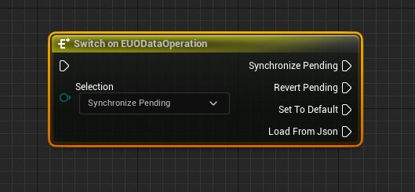
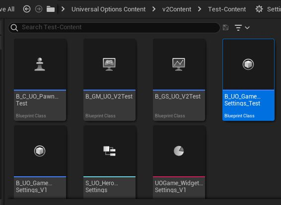
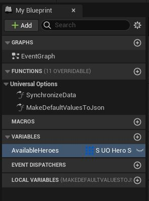
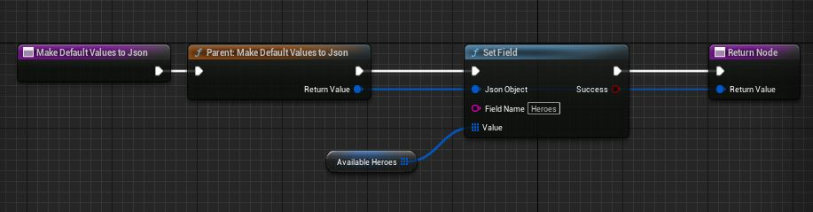
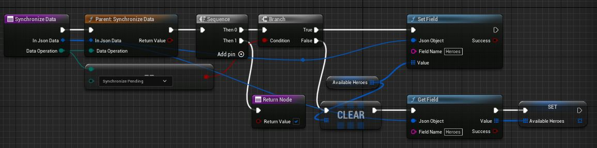

# How Saving Works

You can check [Creating your Own Game Settings](/3-CreatingYourOwnGameSettings.md) for examples of how to implement this in practice.  

## Serialization

As overviewed in [How Settings Work](/1-HowSettingsWork.md), our data gets serialized into and from a `JSON` object. However, Settings being `JSON` Objects is only needed at three stages: Setting Defaults, Loading, and Saving! For the rest of things, you can work with your regular types. All that matters is that we load to and from `JSON`. You can check the section below on [Manual Addition of Data](#manual-addition) for an example of what this looks like.  

### MakeDefaultValuesToJson

We convert our types to JSON and establish the defaults.  

MakeDefaultValuesToJson() happens after running `Initialize()`, so you can load data assets in `Initialize()` so that your defaults have already loaded custom data.  

We feed it to the object that will be treated as default. **Important for whenever we `RESET` our settings, as whatever gets stored here is what is treated as our defaults.**  

### SynchronizeData

Here, we control both Writing to the `JSON` object whenever we store Pending Changes which can be saved, or read from the source depending on the action.  

We have several Data Operation options:  
  

* **Synchronize Pending** is where we want to write to the `JSON`. Say our game modifies our `Available Heroes` Array variable through different points, and we run `Set Pending Changes`. Then `Synchronize Data` runs with `Synchronize Pending` where we can let our `JSON` object catch up.  
* **Revert Pending** is for reading from the `JSON` to undo pending changes. In the example above where the game modified `Available Heroes` but hasn't saved, we then rollback to the last loaded by the system, which can be either `Saved` or `Defaults`.  
* **Set To Default** is for whenever we `RESET` our given settings object, which we then read from what we defined at `MakeDefaultsValuesToJson`.  
* **Load From JSON** Lastly, this runs whenever the data is being loaded from our save file.  

## Supported Types

We can serialize any type of data that is not a UObject. Primitive types, strings, enums, structs are welcome. You can use a `Builder` programming pattern for serializing UObject data into structs and back from structs. [You can find more information on this pattern here](https://refactoring.guru/design-patterns/builder).  

## Registering your Variables

To explain this, let's look at our `Test` Game Settings.  
  

Here, we are going to be demonstrating working with a custom struct, `S_UO_HeroSettings`.  
  

### Automatic Addition

You can now add support to any of your Properties (non-object) by tagging it with SaveGame. Make sure that you didn't tag it as Transient!  

```cpp
//Supports any primitives, FName and FString, as well as Enumerators
UPROPERTY(SaveGame)
bool bMySavedBoolean = false;

//Supports any USTRUCT structures, check "1-Working with JSON" for more information
UPROPERTY(SaveGame)
TArray<FMyStruct> MyStructArray;

//Can also save maps that can convert its key type to a string, such as primitives, strings, and Gameplay Tags. 
UPROPERTY(SaveGame)
TMap<FString, FMyStruct> MyStructMap;
```

Make sure that your Settings class has, either in defaults or Instanced Settings, `bEnableProcessSaveGameProperties` set to true!  

  

Whenever Save Game Property saving is supported, you also have the option to do a deep check of what you'd like to share with `bEnableDeepAnalysisOfSaveGameProperties`. Take the example:  

```text
Say you have the following structure
USTRUCT() struct FMyStruct { UPROPERTY(SaveGame) bool bMyBool, UPROPERTY() float MyFloat }

and then in our settings object,
UPROPERTY(SaveGame) FMyStruct StructVar

bEnableDeepAnalysisOfSaveGameProperties = false means that when we run ToJson(StructVar), where both bMyBool and MyFloat get turned into Json,
{ "bMyBool" : false, "MyFloat" : 42 }

bEnableDeepAnalysisOfSaveGameProperties = true true means we do a recursive check inside FMyStruct, and only bMyBool would get turned into Json.  
{ "bMyBool" : false }
```

### Manual Addition

In `MakeDefaultValuesToJson`:  
  

In `SynchronizeData`:  
  

---

## Save Destinations & Slots (v2.4)

By default every setting saves into the one save file named in your [loaded settings asset](/README.md#loading-settings). As of v2.4 a setting can send its data somewhere else instead — a different file, or a different back-end — by declaring a **save destination** on the setting itself (`UUOSettingsBase`):

| Property | What it does |
|---|---|
| `SaveDestinationName` | The slot (file) this setting writes to. Leave empty to use the project's default save game name. |
| `SaveTypeTag` | A `UniversalOptions.SaveType.*` tag that decides which [save model](#save-backends-save-models) writes the slot. Defaults to the local type. |
| `FallbackLoadSlotNames` | Older slot names to read from if the primary slot doesn't exist yet — handy for migrating a setting to a new file without losing existing saves. |

Under the hood, settings that share a `SaveDestinationName` are grouped into a **save slot** (`UUOSaveSlot`), and the subsystem loads and saves each slot independently (asynchronously where the model supports it). So "graphics in one file, campaign progress in another" is just two settings pointing at two destination names — no manual file handling. The subsystem resolves an empty destination to the default save game name, so existing projects keep saving exactly as before.

## Save Backends (Save Models)

Everything above is about *what* gets serialized, and *which slot* it lands in. **How** that slot is written — the actual bytes to disk, cloud, or elsewhere — is decided separately, by a **save model** (`UUOSaveModel`). A save model is a small, stateless strategy object that describes how a slot's data is loaded and stored — the rest of the system talks to it without caring whether the bytes end up on local disk, on a platform's cloud, or anywhere else.

Two models ship with the plugin:

| Model | Behavior |
|---|---|
| `UUOSaveModel_Local` | **Synchronous** local save. Reads/writes on the same frame and reports back immediately. |
| `UUOSaveModel_LocalAsync` | **Asynchronous** local save. Uses the engine's async save/load so large writes don't hitch the game thread. |

### How a setting picks its backend

Each setting object has a **`SaveTypeTag`** (`UniversalOptions.SaveType.*`). The **Platform Settings** object resolves that tag to a concrete save model (`UUOPlatformSettings::ResolveModel`) and owns the instance — one shared, lazily created instance per model class. The lookup order is:

1. `SaveModelOverrides` on the [Platform Settings](/2-PlatformSettings.md) asset — a map of `SaveType` tag → `UUOSaveModel` class.
2. A built-in default for the tag (the async tag resolves to the async local model).
3. Otherwise, the synchronous local model.

Because the built-in local models are the defaults, existing projects need to change nothing. And because resolution is per platform, the same save type can run through different backends on different platforms.

### The shutdown flush

Save models are async-shaped — every call reports completion through a callback (synchronous models just fire it on the same frame). Two members handle the shutdown case, where there's no time to wait on an async write:

* `SaveSync(SlotName, Data)` — a blocking write used by the [`bForceSyncOnShutdown`](/2-SystemSettings.md#related-save-controls-v24) path and V1 restore.
* `SupportsSyncSave()` — whether `SaveSync` actually writes. Both local models return `true`; if a custom backend can't write synchronously, the shutdown flush falls back to a blocking local write so nothing is lost.

### Writing your own backend (e.g. cloud)

There is no cloud model in the box — instead, cloud/Steam/console/encrypted saving is a plug-in point. Subclass `UUOSaveModel` and implement:

```cpp
UCLASS()
class UMyCloudSaveModel : public UUOSaveModel
{
    GENERATED_BODY()
public:
    // Async-shaped: do the work, then call the callback when it finishes.
    virtual void Load(const FString& SlotName,
        TFunction<void(bool bSuccess, TArray<FUOSaveGameData>)> Callback) const override;

    virtual void Save(const FString& SlotName, const TArray<FUOSaveGameData>& Data,
        TFunction<void(bool bSuccess)> Callback) const override;

    // Optional: blocking write for shutdown. Return true from SupportsSyncSave() if you implement it.
    virtual void SaveSync(const FString& SlotName, const TArray<FUOSaveGameData>& Data) const override;
    virtual bool SupportsSyncSave() const override { return true; }

    virtual void Delete(const FString& SlotName,
        TFunction<void(bool bSuccess)> Callback) const override;
};
```

Then map the save type you want routed to it in `SaveModelOverrides`. Models are created lazily (one instance per class, reused for every slot of that type) and must stay **stateless** — all per-slot data comes in through the `SlotName` / `Data` arguments.  
