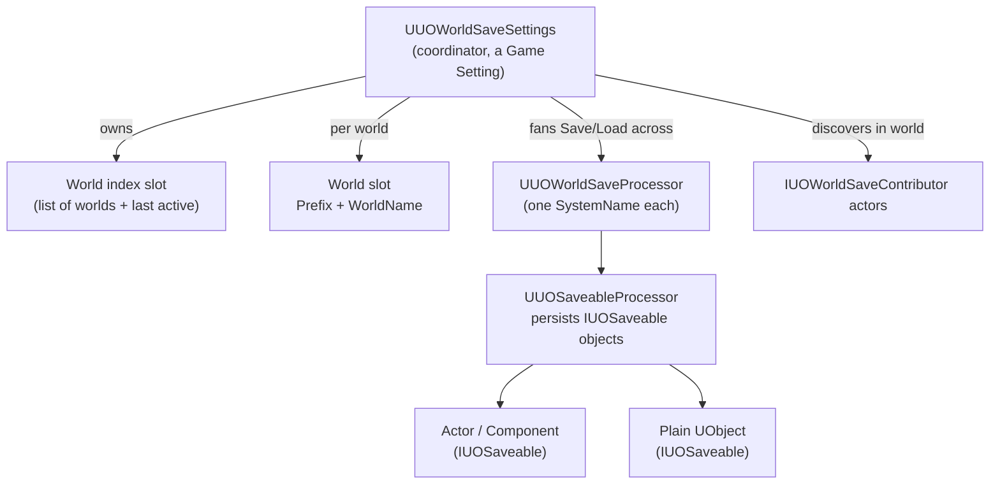

# World Save & Saveables

> **Experimental (v2.4).** This system is shipped as a preview. It works, but its API may change in a future release, and it is not covered by the same stability guarantees as the rest of the plugin. It is also **not networked** — like the rest of Universal Options, nothing here is replicated.

Universal Options' core settings answer "what are the player's preferences?". **World Save** answers a different question: "what is the saved *state* of a playable world, and how do I get it back?" Think named save files for a level, a base, a run, or a save slot in a menu — plus a simple way for actors and objects in that world to persist their own state.

If all you need is options/settings persistence, you do **not** need this page — use the normal [saving flow](/1-HowSavingWorks.md).

---

## When to use it

* You want **multiple, independent save files** ("World A", "World B"), each created, renamed, deleted, and loaded on its own.
* You want per-world **save slots** (autosave, manual slot 1, quicksave…) inside each world.
* You want actors/components to **save and restore their own state** — including respawning things that were created during play — without hand-writing serialization plumbing for each one.

## How it fits together



* **`UUOWorldSaveSettings`** is the coordinator. It is itself a Game Setting (identified by a gameplay tag), so you add it to your settings asset like any other. It keeps a persisted **index** of named worlds and, on Save/Load, fans the call out to its processors.
* Each **world** writes to its **own slot** (`WorldSlotPrefix + WorldName`), so world files stay bounded and can be managed independently.
* A **processor** (`UUOWorldSaveProcessor`) is one contributor of data, identified by a `SystemName`. It implements `GatherPayload` / `ApplyPayload`.
* **`UUOSaveableProcessor`** is the built-in processor that handles object persistence — identity, spawn/removal, and per-object state. This is what powers the Saveables layer below.

## Setup

1. Create a gameplay tag for the coordinator (e.g. `UniversalOptions.Settings.Game.WorldSave`).
2. Add a **`UUOWorldSaveSettings`** entry to your Settings Asset's Game Settings, using that tag.
3. Add **`UUOSaveableProcessor`** (and any custom processors you write) to its `Processor Classes` array.
4. Set `World Slot Save Type Tag` (which save backend the per-world slots use) and, if you want, `World Slot Prefix`.

That's the whole framework side. Now make things saveable.

---

## Saving objects — the easy way (`UUOWorldSaveComponent`)

Drop a **`UUOWorldSaveComponent`** on any actor and it registers itself for you. You give it two bindings:

* **`OnGatherState`** — a return-value delegate. It runs on save and you return the actor's state as an `FInstancedStruct` (any USTRUCT you like — position, health, inventory ids, whatever).
* **`OnApplyState`** — runs on load with that saved struct so you can restore it.

Configure on the component:

* `World Save Settings Tag` — the coordinator tag from setup.
* `Category` — a grouping/type key (not required to be unique).
* `Policy` — see [Spawn policies](#spawn-policies).
* `Spawn Class Override` — for the `Spawned` policy, the class to respawn from (defaults to the owner's class).

The component owns a stable `Persistent Id` (a GUID) that ties a saved record back to the same object across sessions.

## Saving objects — the direct way (`IUOSaveable`)

For full control, implement the **`IUOSaveable`** interface on any actor, component, or plain UObject and register it with the processor (usually in `BeginPlay`):

```cpp
if (UUOSaveableProcessor* Processor =
        UUOSaveableProcessor::GetSaveableProcessor(this, WorldSaveSettingsTag, TEXT("UO.Saveables")))
{
    Processor->RegisterSaveable(this);
}
```

Only three members matter for a plain object:

* `GetSaveId` — a stable GUID. Must be the same across sessions; an invalid GUID skips registration.
* `GatherState(OutState)` — fill in the state to save. Return `false` to leave this object out.
* `ApplyState(InState)` — restore from the saved state.

The rest (`GetSpawnPolicy`, `GetSpawnClass`, `GetSaveTransform`, `SetSaveId`) only matter for actor-backed saveables that need respawning. `UUOWorldSaveComponent` implements all of this for you.

Unregister when the object goes away:

```cpp
Processor->UnregisterSaveable(this, /*bWasDestroyed=*/ true);
```

Pass `bWasDestroyed = true` when the object was genuinely removed from the world (a `Persistent` object removed this way will **not** come back on load); pass `false` for ordinary world teardown or streaming out.

### Spawn policies

`GetSpawnPolicy` decides how an object comes back on load:

| Policy | Meaning |
|---|---|
| **Persistent** | The object already exists on load (placed in the level, or otherwise outlives the save). The processor only applies state to it. |
| **Spawned** | The object was created during play, so it isn't there on load. The processor respawns it from `GetSpawnClass` at `GetSaveTransform`, then applies state. |

Objects removed during a session are tracked, so a reload correctly deletes `Persistent` objects that were destroyed.

---

## Driving it at runtime (the coordinator API)

On `UUOWorldSaveSettings`:

**World catalog:** `CreateWorld`, `DeleteWorld`, `RenameWorld`, `GetWorldList`, `HasWorld`, `GetActiveWorldName`.
**Slots:** `GetWorldSlots(WorldName)` (build a load menu), `GetSlotNameForWorld`, `GetActiveSlotId`. The default slot uses the `None` slot id.
**Save / Load (async):**

| Call | Purpose |
|---|---|
| `SaveWorld(WorldName, OnComplete)` | Save to the world's default slot. |
| `SaveWorldToSlot(WorldName, SlotId, OnComplete)` | Save to a named slot — reuse an id to overwrite, pass a new id to make a new save. |
| `LoadWorld(WorldName, OnComplete)` / `LoadWorldFromSlot(...)` | Load the default or a named slot, then distribute state to processors. |

**Events:** `OnWorldSaved`, `OnWorldLoaded`, `OnActiveWorldChanged`.

A typical flow: `CreateWorld("Save01", …)` from a new-game screen → play → `SaveWorld("Save01")` on a checkpoint → later `LoadWorld("Save01")` from the load menu. Set `bAutoLoadLastActiveWorldOnInit` to auto-resume the last world on startup.

## Advanced: custom processors and world contributors

* Subclass **`UUOWorldSaveProcessor`** to add your own world-level system (give it a unique `SystemName`, implement `GatherPayload` / `ApplyPayload`), and add it to `Processor Classes`. Its payload rides in the same world slot, keyed by its `SystemName`.
* Actors already in the world can implement **`IUOWorldSaveContributor`** and are auto-discovered on world init when `bIncludeWorldActorContributors` is on — handy for level-placed systems that shouldn't have to register manually.

---

## Screenshots to add

This page is diagram + prose for now. Screenshots that would help once captured: the `UUOWorldSaveSettings` entry in the Settings Asset with its `Processor Classes`; a `UUOWorldSaveComponent` on an actor with `OnGatherState` / `OnApplyState` bound; and a simple Save/Load menu wired to `GetWorldList` + `LoadWorld`.
